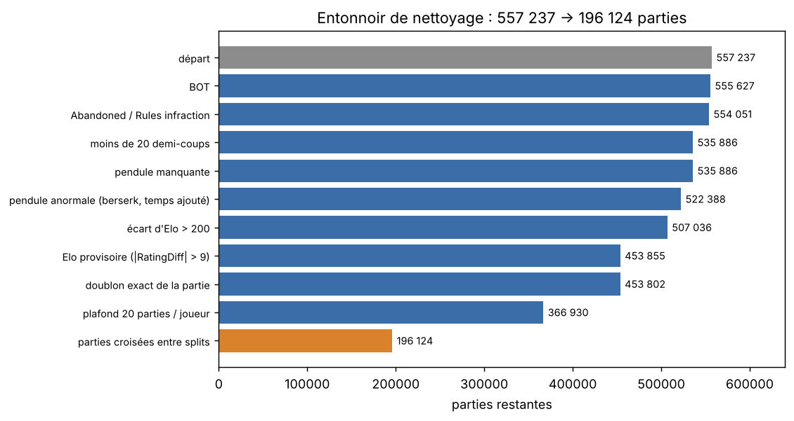
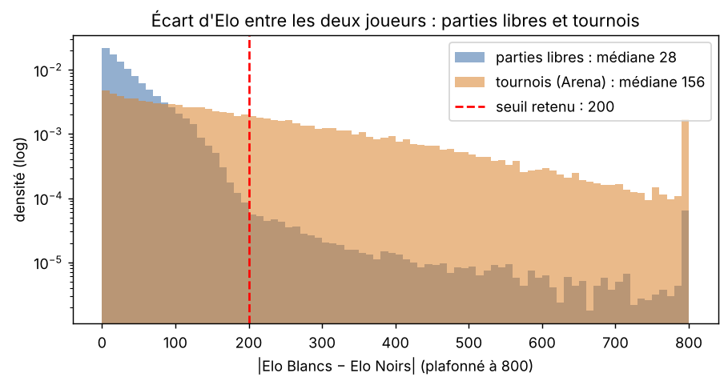
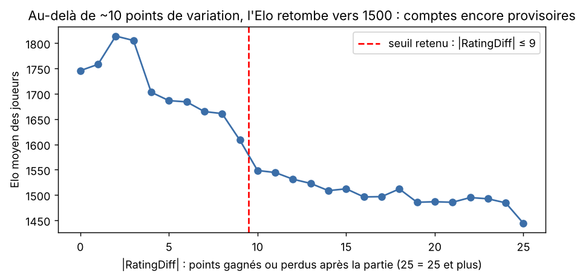
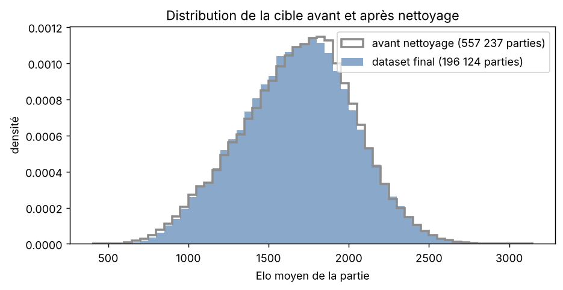
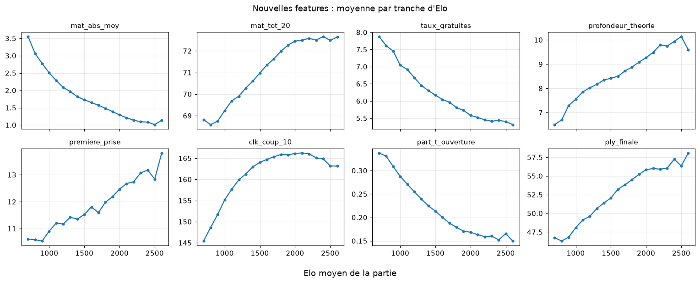
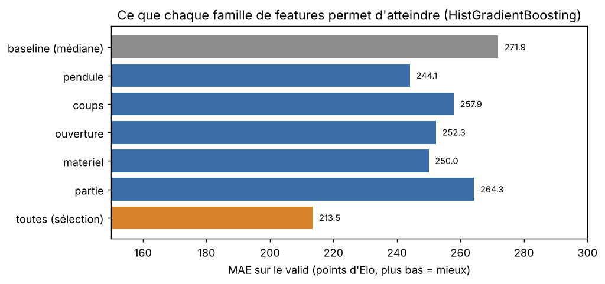
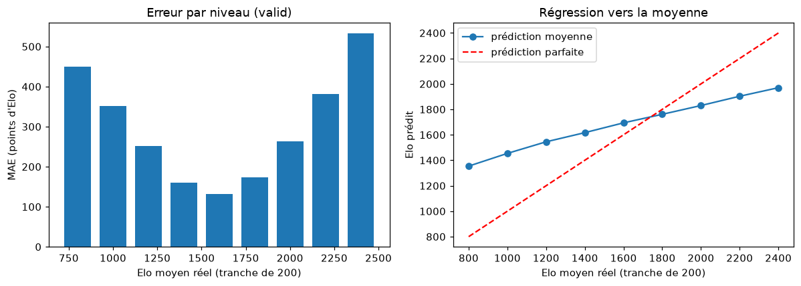
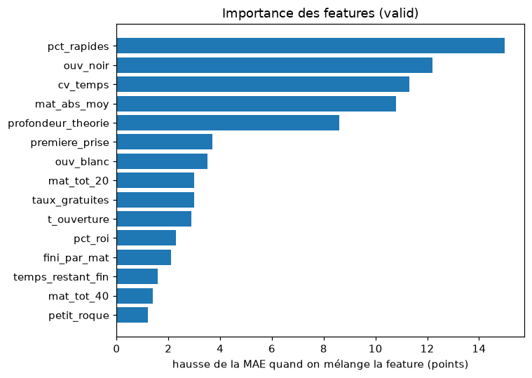
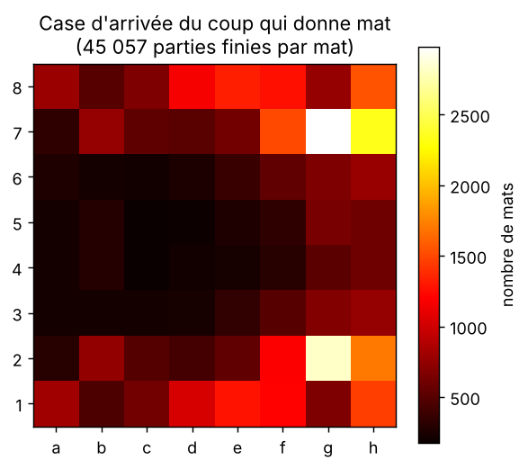

# Compte rendu : estimer le niveau d'une partie d'échecs à partir de la façon de jouer

Ce document a pour but de vous présenter notre projet. Nous y exposons la question que nous nous sommes posée, les
données utilisées, chacune de nos décisions de nettoyage, les variables construites, les modèles retenus ainsi que leurs
limites. Chaque section renvoie vers le notebook qui détaille les calculs correspondants. Les instructions d'installation
et d'exécution figurent dans le [README](README.md).

**Origine des chiffres.** Tous les chiffres cités viennent d'une exécution réelle : les sorties enregistrées des notebooks
de [`rendu_final/`](rendu_final/), confirmées par une ré-exécution complète (téléchargement, nettoyage, features, modèles)
le 08/11/2026. La source de chaque chiffre est indiquée entre parenthèses. Les figures sont produites par
[`rendu_final/figures_compte_rendu.py`](rendu_final/figures_compte_rendu.py), à partir des données et des sorties des notebooks.

---

## 1. Problème et question posée

L'**Elo** est la note de niveau d'un joueur d'échecs : face à un joueur classé 400 points plus bas, un joueur obtient en
moyenne environ 91 % des points (une victoire vaut 1 point, une nulle ½).
Les plateformes en ligne comme Lichess et Chess.com, comme la fédération internationale (FIDE), calculent cette note
**uniquement à partir des résultats** (victoire, nulle, défaite) : la qualité du jeu n'entre jamais dans le calcul.

Conséquence : un **nouveau compte** n'a pas de niveau fiable. Sur Lichess, tout le monde démarre à 1 500, et il faut de
nombreuses parties avant que la note se stabilise. En attendant, les parties sont déséquilibrées : un débutant affronte
des joueurs bien trop forts, un joueur confirmé écrase des débutants.

**Question** : à partir de la seule **façon de jouer** dans une partie (les coups joués et le temps passé sur chaque
coup), peut-on estimer le niveau de cette partie ? La cible est l'**Elo moyen des deux joueurs**.

**Métrique principale** : la **MAE** (*mean absolute error*, erreur absolue moyenne) : la moyenne des écarts entre
l'Elo prédit et l'Elo réel. Exemple : prédire 1 600 pour une partie à 1 700, puis 1 900 pour une partie à 1 800, donne une
MAE de 100 points. Elle se lit directement : « en moyenne, on se trompe de X points ».

**Critère de succès** : faire mieux que deux prédictions naïves : donner **1 500 à tout le monde** (le point de départ de
Lichess) et donner **la médiane** des parties d'entraînement à tout le monde.

Le cadrage complet, avec les sources sur les systèmes de classement, est dans [`rendu_final/CADRAGE.md`](rendu_final/CADRAGE.md).

## 2. Données

- **Source** : la base publique de Lichess, toutes les parties classées de septembre 2026 (un fichier PGN compressé
  d'environ 28 Go). Le **PGN** est le format texte standard des parties d'échecs : des en-têtes (joueurs, Elo, cadence…)
  puis la liste des coups, avec ici le temps restant à la pendule après chaque coup.
- **Extraction** : les 2 millions premières parties du fichier, soit le 1er septembre de 0 h à 16 h UTC, en ne gardant
  que le **blitz 3 minutes** (cadences 180+0 et 180+2) : **557 237 parties**
  (source : `prepare_raw.py` et notebook 01, section 2).
- **Pourquoi une seule cadence** : l'Elo Lichess est calculé séparément pour chaque cadence, et le temps passé sur un coup
  n'est comparable qu'entre parties au même temps de départ.

Code : [`rendu_final/prepare_raw.py`](rendu_final/prepare_raw.py). Il lit le fichier compressé en continu, par morceaux de
100 000 parties, pour ne pas saturer la mémoire.

## 3. Nettoyage : chaque décision est mesurée avant d'être prise

Détail : [`rendu_final/01_nettoyage.ipynb`](rendu_final/01_nettoyage.ipynb) (sections 3 à 7 pour l'audit, 8 et 9 pour les
filtres). Version script : [`src/elo/nettoyage_partie.py`](src/elo/nettoyage_partie.py), qui produit exactement la même table.

La règle suivie : **mesurer d'abord, décider ensuite**. Les sections d'audit ne retirent aucune ligne ; chaque seuil est
ensuite choisi d'après ce qu'elles montrent.

*Figure 1. Nombre de parties restantes après chaque étape (source : notebook 01, sections 8 et 9 ; identique avec le
script `nettoyage_partie.py`).*

### Ce que l'audit a montré, et les décisions qui en découlent

| constat (source : notebook 01) | décision |
|---|---|
| 1 610 parties avec un **BOT** (programme informatique) | retirées : ses coups ne décrivent pas un humain |
| 18 165 parties de **moins de 20 demi-coups** (un demi-coup = le coup d'un seul joueur) | retirées : trop peu d'information |
| le **berserk** (un joueur divise volontairement son temps par deux) concerne 26 % des parties de tournoi, contre 0,04 % des parties libres (section 5) | parties à pendule anormale retirées : gestion du temps non comparable |
| l'**écart d'Elo** entre les deux joueurs a une médiane de 28 points en partie libre, mais de 156 en tournoi (section 6.2, figure 2) | écart limité à 200 : au-delà, la moyenne des deux Elo ne décrit le niveau d'aucun des deux joueurs |
| au-delà d'environ 10 points de **RatingDiff** (points gagnés ou perdus après la partie), l'Elo moyen retombe vers 1 500 (section 6.3, figure 3) | \|RatingDiff\| ≤ 9 : une forte variation signale un compte récent dont l'Elo n'est pas encore fiable |
| les annotations `?!` ou `??` apparaissent dans 53 061 parties, **toutes** analysées par ordinateur, et l'analyse est bien plus fréquente chez les forts : 49 % des parties au-dessus de 2 600 contre 8 % vers 1 600 (sections 4.2 et 4.3) | annotations retirées et évaluations ordinateur ignorées : elles trahiraient le niveau sans venir du jeu (**fuite d'information**) |
| 160 772 joueurs, 4 parties pour le joueur médian mais 228 pour le plus actif ; les joueurs à 20 parties ou plus fournissent 33 % des lignes (section 7.1) | au plus 20 parties par joueur |
| 0 coup illégal sur 20 000 parties rejouées avec la bibliothèque `python-chess` (section 4.4) | les coups sont fiables |

Une **fuite d'information** (*data leakage*) est une variable qui donne la réponse au modèle sans venir de ce qu'on veut
réellement mesurer. Exemple : si l'on gardait l'Elo de l'adversaire, très corrélé à celui du joueur, le modèle n'aurait
plus rien à apprendre des coups.

*Figure 2. Écart d'Elo entre les deux joueurs, en parties libres et en tournoi (échelle logarithmique). Le seuil de 200
garde presque toutes les parties libres et écarte la queue des tournois (source : `Data/blitz_180_raw_full.parquet`).*

*Figure 3. Elo moyen des joueurs selon les points gagnés ou perdus après la partie. La chute après 9 justifie le seuil
(source : `Data/blitz_180_raw_full.parquet`, parties à écart d'Elo ≤ 200).*

### Le découpage entraînement / validation / test se fait par joueur

Un modèle s'entraîne sur un jeu de données (**train**), on choisit le meilleur sur un deuxième (**valid**), et on mesure
sa performance finale sur un troisième jamais utilisé avant (**test**).

Ici, ce découpage se fait **par joueur** : un même joueur garde presque le même Elo et le même style toute la journée. Si
ses parties étaient réparties entre train et test, le modèle pourrait reconnaître le joueur au lieu d'estimer son niveau,
et le score serait trop optimiste. Chaque joueur reçoit donc un groupe (70 % train, 15 % valid, 15 % test), et seules les
parties dont les deux joueurs sont dans le même groupe sont gardées.

Ce choix a un coût : **170 806 parties** sont écartées, et valid et test ne font que 8 428 et 8 340 parties
(source : notebook 01, section 9.2). Douze contrôles automatiques vérifient ensuite la table finale (section 10).

### Le nettoyage ne déforme pas la cible

*Figure 4. Distribution de l'Elo moyen avant et après nettoyage. Moyenne 1 680 et écart-type 353 avant, 1 679 et 348
après (source : notebook 01, section 10).*

**Résultat : 196 124 parties**, réparties en 179 356 (train), 8 428 (valid) et 8 340 (test).

## 4. Features : décrire la façon de jouer avec des nombres

Détail : [`rendu_final/02_features.ipynb`](rendu_final/02_features.ipynb). Code :
[`src/elo/features_partie.py`](src/elo/features_partie.py) et [`src/elo/features.py`](src/elo/features.py).

Une **feature** (variable explicative) est un nombre calculé à partir des données brutes, que le modèle utilise pour
prédire. Exemple : la part des coups joués en moins d'une seconde. Les features sont calculées **uniquement à partir des
coups et de la pendule**, pour chaque couleur, puis moyennées sur la partie. Cinq familles :

| famille | exemples | idée |
|---|---|---|
| pendule | temps passé sur l'ouverture, part de coups rapides, régularité du temps de réflexion | les joueurs forts jouent l'ouverture de mémoire |
| coups | part de captures, d'échecs, roque | le style de jeu |
| ouverture | nombre de demi-coups pendant lesquels la partie suit une suite déjà jouée au moins 20 fois dans le train, réponse des Noirs au premier coup | les forts connaissent plus de théorie |
| matériel | déséquilibre de matériel au fil de la partie, pièces laissées gratuitement | partie rejouée avec `python-chess` : les faibles perdent plus de pièces |
| partie | longueur, cadence | contexte |

Toute l'analyse (corrélations, sélection) est faite sur le **train** seulement ; le test n'est pas ouvert dans ce notebook.
Sur 41 features numériques candidates, 33 sont gardées : 6 sont retirées car redondantes avec une autre, 2 car elles
n'expliquent presque rien de l'Elo (source : notebook 02, section 6).

*Figure 5. Moyenne de quelques features par tranche d'Elo (train). Les relations sont nettes mais pas toujours
linéaires (source : sortie du notebook 02, section 4).*

*Figure 6. MAE atteinte sur le valid avec chaque famille seule, puis avec toutes les features. Aucune famille ne suffit
seule ; ensemble, elles gagnent 58 points sur la médiane (source : notebook 02, section 7).*

## 5. Modèles et résultats

Détail : [`rendu_final/03_modeles.ipynb`](rendu_final/03_modeles.ipynb).

Deux modèles sont comparés aux deux références naïves :
- la **régression Ridge** : une régression linéaire (l'Elo prédit est une somme pondérée des features), avec une
  pénalité qui empêche les poids de devenir énormes quand des features se ressemblent ;
- le **HistGradientBoosting** : un ensemble d'arbres de décision construits les uns après les autres, chacun corrigeant
  les erreurs des précédents. Il capte les relations non linéaires, par exemple une feature qui augmente puis diminue avec l'Elo.

Le modèle est choisi sur le valid ; le test n'est utilisé **qu'une seule fois**, à la fin. L'**intervalle de confiance**
(IC 95 %) indique entre quelles valeurs la MAE aurait pu tomber avec un autre échantillon de parties de même taille : il
est obtenu par *bootstrap* : on tire 1 000 fois au hasard, avec remise, un échantillon de la taille du valid, et on
recalcule la MAE à chaque fois.

| modèle | MAE valid (IC 95 %) | MAE test | R² test |
|---|---|---|---|
| 1 500 pour tout le monde | 313,3 | 322,4 | −0,30 |
| médiane du train | 271,9 | 276,6 | 0,00 |
| Ridge | 224,7 (221,2 – 228,2) | | |
| **HistGradientBoosting** | **213,5** (209,9 – 217,1) | **212,2** | **0,40** |

*Source : notebook 03, sections 5 et 8.* Le **R²** mesure la part de la variation de l'Elo expliquée par le modèle :
0 pour une prédiction constante, 1 pour une prédiction parfaite ; il est négatif quand on fait pire qu'une constante bien
choisie, comme « 1 500 pour tout le monde ».

**Lecture**
- Le boosting gagne **64 points** sur la médiane et **110 points** sur « 1 500 pour tout le monde ».
- La MAE du test (212,2) est très proche de celle du valid (213,5) : le modèle n'a pas été ajusté au valid.
- L'écart entre boosting et Ridge (environ 11 points) dépasse nettement l'incertitude : il n'est pas dû au hasard.

### Où le modèle se trompe

*Figure 7. À gauche, l'erreur par niveau ; à droite, la prédiction moyenne selon l'Elo réel (source : sortie du
notebook 03, section 6, sur le valid).*

L'erreur est d'environ 130 points vers 1 600, mais de 450 vers 800 et de 530 vers 2 400. Le modèle ramène ses
prédictions vers le centre : c'est la **régression vers la moyenne**. Quand l'information est bruitée, la prédiction la
plus sûre est proche de la moyenne : une seule partie ne suffit pas à reconnaître avec certitude un joueur très faible
ou très fort.

### Ce sur quoi le modèle s'appuie

*Figure 8. Importance par permutation : de combien la MAE augmente quand on mélange au hasard une feature dans le valid
(source : sortie du notebook 03, section 7).*

Les features les plus utiles sont la part de coups rapides, la réponse des Noirs à l'ouverture, la régularité du temps
de réflexion, le déséquilibre de matériel et la profondeur de théorie.

## 6. Visualisation sur l'échiquier

*Figure 9. Case d'arrivée du coup qui donne mat, sur les 45 057 parties du dataset final finies par mat (hors mats donnés
par un roque). Les mats se concentrent près des rois roqués (g7, g2, h7) et sur les dernières rangées : les mats du
couloir (source : `Data/blitz_180_parties.parquet`, avec les classes `Move` et `Chessboard` de la branche de
visualisation, dans [`par_personne/pl/`](par_personne/pl/)).*

## 7. Limites et pistes

**Limites**
- **Une seule journée** de blitz 3 minutes : rien ne garantit que le modèle fonctionne aussi bien un autre jour ou à une
  autre cadence.
- **Population filtrée** : pas de comptes provisoires, peu de tournois. Or le cas d'usage visé, les nouveaux comptes, est
  justement exclu de l'entraînement : le modèle apprend sur des joueurs à l'Elo fiable, et son application à des comptes
  récents reste à vérifier.
- **Pas de mesure directe de la qualité des coups** : sans moteur d'échecs, le matériel n'en est qu'une approximation.
  Une erreur positionnelle ne coûte pas de pièce.
- **Valid et test petits** (environ 8 400 parties chacun) à cause du découpage par joueur.

**Pistes**
- Estimer le niveau d'un **joueur** à partir de plusieurs parties : utile pour repérer un compte mal classé ou un
  *smurf* (un joueur confirmé sur un compte au classement plus bas).
- Ajouter d'autres jours de données et tester le modèle sur un jour qu'il n'a jamais vu.
- Des features d'échiquier plus fines (structure de pions, sécurité du roi), ou des séquences de coups.

## 8. Utilisation de l'IA

Une partie du travail a été réalisée avec l'assistant **Claude Code** (Anthropic), principalement :
- pour la **réflexion sur le projet** : cadrage de la question, choix de la cible, discussion des décisions de nettoyage
  et de modélisation ;
- pour la **fusion des branches et la structuration de la version finale** du dépôt.

Tout le travail produit avec cet outil a été **relu et corrigé par nous**.
