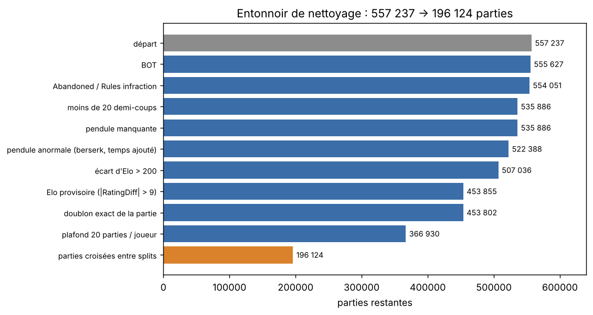
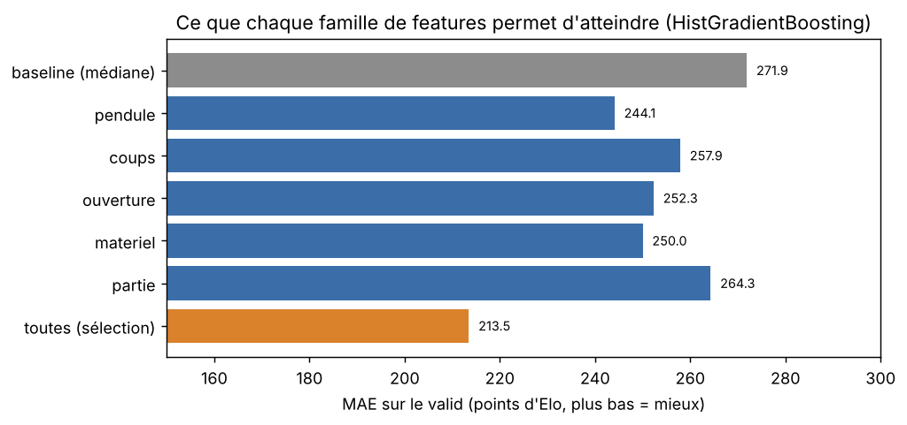
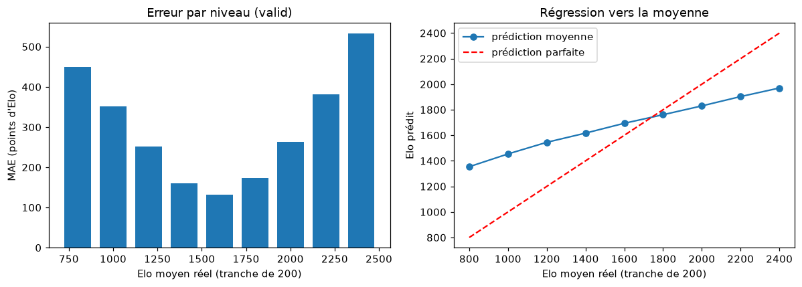

# ChessProject : estimer le niveau d'une partie d'échecs à partir des coups

Projet de data science (cours KIT DS, Télécom Paris) sur les parties publiques de [Lichess](https://database.lichess.org/).

## Objectif

Les plateformes d'échecs calculent l'Elo (la note de niveau) uniquement à partir des résultats : un nouveau compte n'a donc
pas de niveau fiable au départ. Nous cherchons à estimer le niveau d'une partie de blitz (l'**Elo moyen des deux joueurs**)
à partir de la seule **façon de jouer** : les coups joués et le temps passé sur chaque coup.

**Résultat** : sur 8 340 parties de test, jouées par des joueurs absents de l'entraînement, le meilleur modèle se trompe en
moyenne de **212 points d'Elo** (MAE), contre 277 en prédisant toujours la médiane et 322 en prédisant 1 500 pour tout le
monde, le point de départ d'un nouveau compte sur Lichess.

Pour la démarche détaillée, les choix et leur justification : **[COMPTE_RENDU.md](COMPTE_RENDU.md)**.

## Structure du dépôt

| chemin | contenu |
|---|---|
| `rendu_final/prepare_raw.py` | étape 0 : télécharge le PGN et extrait les parties de blitz 3 min |
| `src/elo/nettoyage_partie.py` | étape 1 : nettoyage, découpage train / valid / test, contrôles |
| `rendu_final/01_nettoyage.ipynb` | étape 1 en notebook : l'audit qui justifie chaque seuil |
| `rendu_final/02_features.ipynb` | étape 2 : construction et sélection des features (code dans `src/elo/features_partie.py`) |
| `rendu_final/03_modeles.ipynb` | étape 3 : modèles, évaluation, analyse des erreurs |
| `rendu_final/figures_compte_rendu.py` | figures du compte rendu (dans `figures/`) |
| `rendu_final/CADRAGE.md`, `rendu_final/RECAP_dataset.md` | cadrage du projet, fiche du dataset nettoyé |
| `src/elo/`, `src/utils/` | code réutilisé : lecture du PGN, nettoyage, features |
| `archives/` | première approche abandonnée (prédire l'Elo de chaque joueur), voir [`archives/README.md`](archives/README.md) |
| `par_personne/` | brouillons et explorations individuelles, dont la visualisation d'échiquier |

## Installation

Python 3.14 et [uv](https://docs.astral.sh/uv/getting-started/installation/), depuis la racine du projet :

```bash
uv sync
```

Sans uv : `pip install -r requirements.txt` puis `pip install -e .`. Pour les notebooks, choisir le kernel du `.venv`.

## Lancer le projet, dans l'ordre

Toutes les commandes se lancent depuis la racine. Les données vont dans `Data/`, qui n'est pas versionné.

```bash
uv run python rendu_final/prepare_raw.py
```

```bash
uv run python -m elo.nettoyage_partie
```

Puis exécuter les notebooks `rendu_final/02_features.ipynb` et `rendu_final/03_modeles.ipynb`, et enfin :

```bash
uv run python rendu_final/figures_compte_rendu.py
```

| étape | durée indicative | sortie |
|---|---|---|
| 0. Données | 1 à 2 min, plus le téléchargement | `Data/blitz_180_raw_full.parquet` |
| 1. Nettoyage (script ou notebook 01) | moins d'1 min | `Data/blitz_180_parties.parquet` |
| 2. Features | plusieurs minutes (parties rejouées avec `python-chess`) | `Data/blitz_180_features_partie.parquet` |
| 3. Modèles | quelques minutes | scores et graphiques dans le notebook |

Le script de l'étape 0 télécharge le fichier complet (~28 Go) s'il est absent. Seul le début du fichier sert : les 2 millions
de parties lues tiennent dans le premier 1,3 Go environ.

## Données

- **Source** : toutes les parties classées Lichess de septembre 2026, au format PGN (en-têtes puis liste des coups, avec le
  temps restant à la pendule après chaque coup).
- **Extraction** : les 2 millions premières parties (1er septembre, de 0 h à 16 h UTC), limitées au blitz 3 minutes
  (180+0 et 180+2) : **557 237 parties**.
- **Après nettoyage** : **196 124 parties**, une ligne par partie, découpées **par joueur** en train (179 356), valid (8 428)
  et test (8 340), pour qu'aucun joueur n'apparaisse dans deux groupes.
- **Cible** : `elo_moyen`, la moyenne des Elo des deux joueurs. Les Elo, le résultat de la partie et les évaluations par
  ordinateur ne sont jamais utilisés comme variables explicatives.



## Résultats clés

| modèle | MAE valid | MAE test | R² test |
|---|---|---|---|
| 1 500 pour tout le monde | 313,3 | 322,4 | −0,30 |
| médiane du train | 271,9 | 276,6 | 0,00 |
| Ridge (régression linéaire) | 224,7 | | |
| **HistGradientBoosting** | **213,5** | **212,2** | **0,40** |

*Source : notebook 03. Le modèle est choisi sur le valid ; le test n'est utilisé qu'une fois, à la fin.*



Les features de **pendule** sont les plus informatives, mais chaque famille apporte quelque chose : ensemble, elles gagnent
58 points sur la médiane.



L'erreur est faible au milieu (environ 130 points vers 1 600) et forte aux extrêmes (450 vers 800, 530 vers 2 400) : le
modèle ramène ses prédictions vers la moyenne.

## Limites

- Une seule journée de blitz 3 minutes, et une population filtrée (pas de comptes provisoires, peu de tournois).
- Pas de mesure directe de la qualité des coups : sans moteur d'échecs, le matériel perdu n'en est qu'une approximation.
- Valid et test petits (environ 8 400 parties chacun), conséquence du découpage par joueur.
- Une seule partie est un indice bruité du niveau : les joueurs très faibles ou très forts restent mal estimés.
