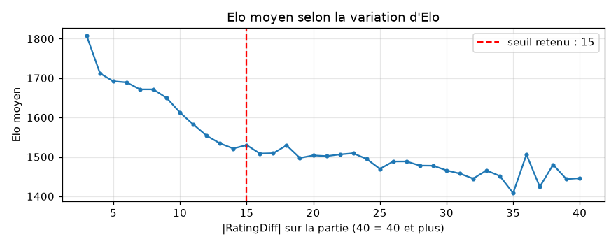
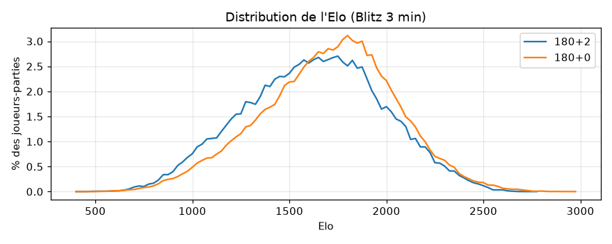
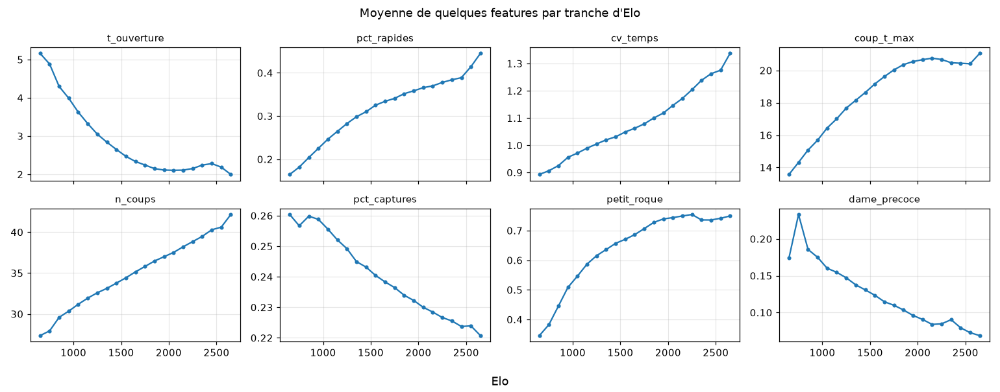
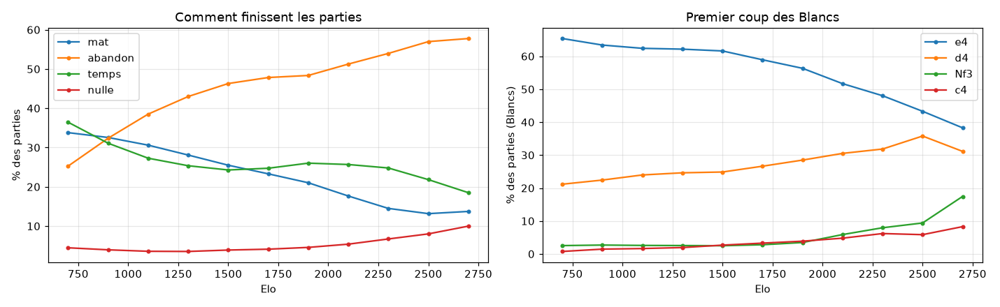
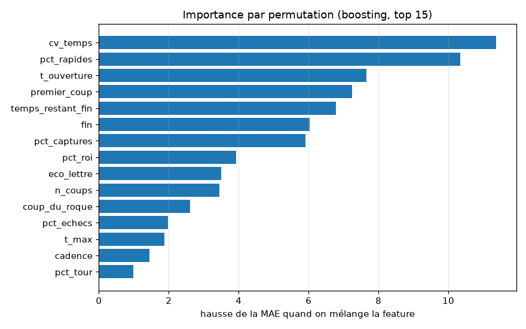
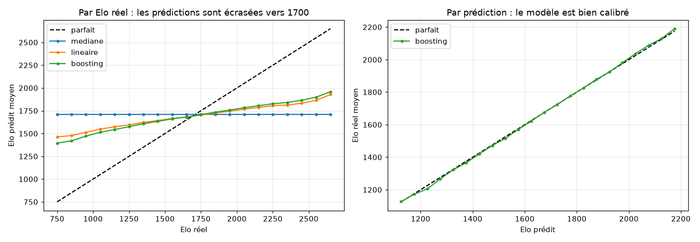
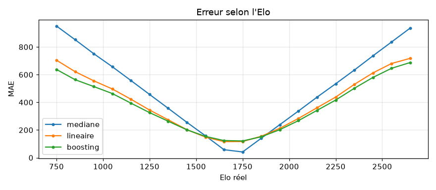
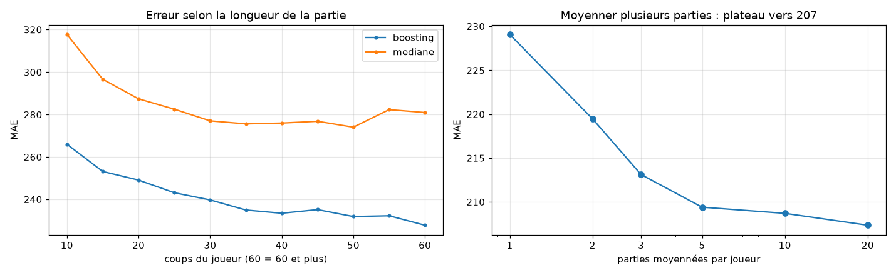

# ChessProject : prédire l'Elo d'un joueur à partir de ses coups

Projet ML (cours KIT DS, Télécom Paris), sur les parties publiques de [Lichess](https://database.lichess.org/).
**Question** : en regardant une seule partie (les coups d'un joueur et sa gestion de la pendule), peut-on deviner son Elo ?

**Où on en est** : sur 1M de joueurs-parties en Blitz 3 min, le meilleur modèle (gradient boosting) se trompe en
moyenne (MAE) de 241 points d'Elo, contre 283 en prédisant toujours la médiane (R² = 0,27). Les raisons de cette
performance modeste sont analysées [plus bas](#pourquoi-les-modèles-ne-sont-pas-encore-performants) ; la suite est
dans [`TODO.md`](TODO.md).

---

## Installation

1. Installer [uv](https://docs.astral.sh/uv/getting-started/installation/).
2. Dans le dossier du projet :
   ```bash
   uv sync
   ```
   Ça crée le `.venv` et installe tout (Python 3.14, polars, scikit-learn…) d'après `uv.lock`.
   Le projet est installé en mode éditable : le code de `src/` s'importe partout (`from elo.features import ...`,
   `from utils.pgn import ...`) et chaque modif est prise en compte sans réinstaller (dans un notebook : redémarrer le kernel).
   Si l'import ne marche pas : `uv pip install -e .`.
3. Pour les notebooks, choisir le kernel `.venv` dans VS Code / Jupyter.

Ajouter une librairie : `uv add nom_lib` (puis commit `pyproject.toml` et `uv.lock`). Ne jamais faire `pip install` à la main.

## Lancer le pipeline

Tout passe par un seul point d'entrée :

```bash
uv run python -m elo tout                 # toutes les étapes, dans l'ordre (~4 min, + téléchargement la 1re fois)
uv run python -m elo modeles figures      # seulement certaines étapes
uv run python -m elo --help
```

| étape | ce qu'elle fait | sortie (dans `Data/`) | durée |
|---|---|---|---|
| `extraction` | télécharge le PGN s'il manque (⚠️ **~28 Go**), garde les parties Blitz 3 min | `blitz_180_raw.parquet` | 1-4 min |
| `nettoyage` | filtres, 1 ligne par joueur et par partie | `blitz_180_joueurs.parquet` | ~15 s |
| `features` | 24 features numériques + 5 catégorielles | `blitz_180_features.parquet` | ~5 s |
| `modeles` | split par joueur, médiane / linéaire / boosting, scores | `predictions_test.parquet`, `importances.parquet` | ~2 min |
| `figures` | graphes de ce README | `figures/*.png` | ~15 s |

Les paramètres (chemins, cadences, seuils) sont tous dans [`src/elo/config.py`](src/elo/config.py).

## Organisation du repo

| Dossier | Contenu | Sur git ? |
|---|---|---|
| `src/elo/` | **Le pipeline** : une étape = un module court (`extraction`, `nettoyage`, `features`, `modeles`, `figures`) | Oui |
| `src/utils/` | Outils génériques : lecture du PGN (`pgn.py`), classe `Move`, échiquier (`chessboard.py`) | Oui |
| `notebooks/` | Notebooks **communs** : l'analyse détaillée, pas à pas, avec les justifications | Oui |
| `figures/` | Graphes générés par `python -m elo figures` | Oui |
| `notebook<prenom>/` | Ton brouillon perso (tests, essais) | **Non** |
| `Data/` | Données (PGN + parquets générés) | **Non** |

Les notebooks racontent la démarche, les scripts la rendent reproductible :
`00_extraction` → `01_exploration` (nettoyage) → `02_preparation` → `03_features` → `04_modeles`.

---

## Démarche et résultats

### 1. Données

- Source : toutes les parties classées Lichess de septembre 2026 (28 Go compressé, ~2,2M parties par jour).
- On lit les **2M premières parties** (~24 h du 1er septembre) en streaming et on garde le **Blitz 3 min**
  (180+0 et 180+2) : **557 237 parties**.
- Pourquoi une seule famille de cadence : l'Elo Lichess est propre à chaque cadence, et la pendule n'est comparable
  qu'à temps égal.

Chaque partie fournit, pour chaque coup, sa notation (SAN : `e4`, `Nxf3+`, `O-O`…), le temps restant à la pendule et,
pour 9 % des parties, l'évaluation de l'ordinateur.

### 2. Nettoyage

La cible est l'Elo d'**un** joueur prédit à partir de **ses** coups : chaque partie donne **2 lignes** (Blancs, Noirs).

| niveau | règle | pourquoi | retiré |
|---|---|---|---|
| partie | un joueur est un BOT | ni son Elo ni ses coups ne décrivent un humain | 1 610 parties |
| partie | `Abandoned` / `Rules infraction` | coups non représentatifs (partie quittée, triche) | 1 576 parties |
| partie | moins de 10 coups par joueur | surtout des pertes au temps « joueur absent » | 18 165 parties |
| joueur | Elo provisoire : \|RatingDiff\| > 15 | Elo pas encore stable = mauvaise cible | 3,1 % des lignes |
| joueur | pendule anormale (berserk, temps offert) | gestion du temps non comparable | 1,4 % des lignes |

**Résultat : 1 023 985 lignes joueur-partie**, ~149k joueurs distincts.

Le seuil de 15 n'est pas arbitraire : au-delà, l'Elo moyen des joueurs se stabilise vers 1450-1500 (plateau) ;
c'est une autre population, des comptes récents partis de 1500 dont l'Elo bouge beaucoup.



### 3. La cible et les pièges



- Elo ≈ **1700 ± 350**, en cloche ; les joueurs 180+2 sont ~80 points plus bas qu'en 180+0.
- **Baseline** : prédire toujours la médiane → MAE = **283**.
- **Fuites évitées** :
  - l'Elo adverse est corrélé à 0,96 avec celui du joueur (Lichess fait des partie avec des joueur de meme niveau) : jamais en feature,
    pas plus que `RatingDiff` ; pour la même raison, le résultat de la partie est presque inutile ;
  - un même joueur a un Elo quasi constant sur la journée (écart-type ~6 points) : le split train/test se fait par
    joueur, sinon le modèle reconnaît le joueur au lieu d'estimer son niveau ;
  - la présence d'une évaluation (`%eval`) dépend de l'Elo (7 % des parties vers 1600, plus de 60 % au-dessus de 2600) :
    c'est pas une feature.

### 4. Features

Calculées avec Polars, uniquement à partir des coups du joueur (ceux de l'adversaire renseignent sur le niveau adverse).

| famille | exemples | idée |
|---|---|---|
| pendule | `t_ouverture`, `pct_rapides`, `cv_temps`, `coup_t_max`, `pct_zeitnot` | les forts jouent l'ouverture de mémoire et ont un rythme irrégulier |
| coups (SAN) | `pct_captures`, `pct_echecs`, part de chaque pièce, roque, `dame_precoce` | le style : les débutants prennent, font échec, sortent la dame tôt |
| fin de partie | `fin` (mat donné/reçu, abandon, temps, nulle), `n_coups` | les faibles se font mater, les forts abandonnent |
| ouverture | `premier_coup`, `eco_lettre` | `e4`/`e5` chez les faibles, `Nf3`/`c4`/`Nf6` chez les forts |





Aucune feature seule n'est très liée à l'Elo : la plus corrélée (`t_ouverture`) a une corrélation de Spearman de
-0,27. Plusieurs relations sont en U (`pct_zeitnot`, `temps_restant_fin`…).

### 5. Modèles

- Split 80/20 (parce que on fait souvent 80/20 dans la littérature) par joueur (`GroupShuffleSplit`) : 819k lignes de train, 205k de test, aucun joueur commun.
- Prétraitement dans un `Pipeline` sklearn (appris sur le train seulement).
- Pas de Random Forest (même famille que le boosting, mais lente sur 1M lignes *recommandé par Claude*) ni de PCA (peu de features).

| modèle | MAE | RMSE | R² |
|---|---|---|---|
| médiane | 283 | 353 | 0 |
| régression linéaire | 249 | 311 | 0,22 |
| HistGradientBoosting | **241** | **301** | **0,27** |



La **pendule domine** (`cv_temps`, `pct_rapides`, `t_ouverture`), puis l'ouverture, la fin de partie et les captures.
Une quinzaine de features n'apportent presque rien une fois les autres présentes (ex. `petit_roque`, pourtant corrélée
à l'Elo : son information est déjà portée par d'autres features).

### 6. Analyse des erreurs







- Figure en haut

**À gauche du 1er graphe** : un joueur à 750 est prédit ~1400 en moyenne, un joueur à 2650 ~1950. L'erreur est ~120
  au centre mais 600-700 aux extrêmes.
**À droite** : regroupés par **prédiction**, les joueurs ont bien en moyenne l'Elo prédit : le modèle est
  **calibré**, il n'est pas biaisé, il manque d'information pour distinguer les niveaux.

en gros : 

Graphe de gauche : « Prenons tous les joueurs qui ont vraiment 800 d'Elo. Qu'est-ce que le modèle leur prédit, en moyenne ? » Réponse : environ 1450. Le modèle les surestime.

Graphe de droite : « Prenons tous les joueurs à qui le modèle a prédit 1300. Quel est leur vrai Elo, en moyenne ? » Réponse : environ 1320. Le modèle avait raison.

- Les parties plus longues sont mieux prédites, mais même les parties courtes apportent ~40-50 points de gain :
  le seuil de 10 coups par joueur est validé.
- Moyenner les prédictions de plusieurs parties d'un même joueur fait baisser l'erreur de 229 à ~207, puis **plateau**
  dès 5 parties.

---

## Pourquoi les modèles ne sont pas (encore) performants

Hypothèses, de la plus probable à la moins probable, avec ce qui les appuie.

1. **Les features décrivent la *forme* des coups, pas leur *qualité*.** On sait si un joueur prend, fait échec ou
   joue vite, mais pas si son coup était bon. Or c'est la qualité des coups qui fait l'Elo. Indices : aucune feature
   au-dessus de |ρ| = 0,27, R² = 0,27, et les deux familles les plus « qualitatives » (échiquier, évaluations) ne
   sont pas encore utilisées.

2. **L'erreur est un biais par joueur, pas du bruit.** Si l'erreur venait seulement de la variabilité d'une partie à
   l'autre, moyenner 20 parties la ferait fondre. Elle plafonne à ~207 dès 5 parties : pour un joueur donné, le modèle se
   trompe toujours dans le même sens. Plus de parties n'aidera pas ; il faut de meilleures features.

3. **La régression vers la moyenne est la conséquence normale d'un signal faible**, pas un défaut à corriger.
   Le modèle est calibré (graphe de droite). Nous avons testé deux « corrections » :
   - **étirer les prédictions** autour de 1700 (×1,5 à ×3) : pour que la courbe colle à la diagonale (×3), la MAE monte
     à 367, pire que la médiane ;
   - **équilibrer les tranches d'Elo** (poids à l'entraînement) : MAE aux extrêmes 660 → 508, mais MAE globale 241 → 258.

   Dans les deux cas on **déplace** l'erreur du centre vers les extrêmes, sans gagner d'information.

4. **Une partie est un échantillon très bruité du niveau.** En blitz, on peut jouer très au-dessus ou très en
   dessous de son niveau, et l'appariement par Elo fait que le résultat ne dit presque rien. Une partie isolée ne
   pourra jamais être prédite parfaitement (erreur incompressible).

5. **La cible elle-même est imparfaite** (effet plus faible) : un Elo Lichess a une incertitude de plusieurs dizaines
   de points, les Elo provisoires ne sont filtrés qu'approximativement (via `RatingDiff`), et 180+0 / 180+2 ne sont pas
   exactement la même population.

**Ce qu'on en tire** : la prochaine marche n'est pas un modèle plus complexe mais **plus de signal** : features
d'échiquier (pièces laissées en prise, matériel perdu), séquences de coups (n-grammes), et les évaluations quand
elles existent. Voir [`TODO.md`](TODO.md).

---

## Piste : prédire le niveau d'un joueur, plus seulement d'une partie

Jusqu'ici, la question posée au modèle est : **« quel est le niveau de ce joueur *sur cette partie* ? »**. Or une
seule partie est un indice bruité : en blitz, un joueur à 1400 peut jouer comme un 1000 (fatigue, gaffe) ou comme un
1800, et il bat un 1800 environ 9 % du temps.

La question qui nous intéresse vraiment est plutôt : **« quel est le niveau de ce joueur ? »**. Idée : prendre les
joueurs qui ont au moins 10 parties, et prédire leur **Elo moyen** à partir de l'ensemble de leurs parties.

**Ce qu'on a dans nos données** (1 journée) :

| joueurs avec au moins… | joueurs | Elo moyen | écart-type entre joueurs | variation de l'Elo d'un joueur sur la journée |
|---|---|---|---|---|
| 5 parties | 67 000 | 1677 | 350 | ~7 points |
| **10 parties** | **32 000** | 1710 | 341 | ~8 points |
| 20 parties | 10 000 | 1751 | 328 | ~11 points |
| (tous) | 149 000 | 1626 | 365 | |

L'Elo bouge très peu sur la journée : l'Elo moyen est une cible propre. Pour atteindre 50 000 joueurs avec 10 parties,
il faudrait ~2 jours de données.

**Pourquoi c'est intéressant**
- Ça répond à la vraie question (le niveau d'un joueur), et ça retire le bruit « bonne ou mauvaise partie ».
- Ça permet des features impossibles sur une partie : la **régularité** du joueur d'une partie à l'autre, la
  **diversité de son répertoire** d'ouvertures, la part de ses parties perdues au temps…
- C'est différent de ce qu'on a déjà testé : moyenner les prédictions partie par partie plafonne à ~207. Ici, le modèle
  apprendrait directement sur des features moyennées sur 10 parties, beaucoup moins bruitées.

**Attention**
- **Biais de sélection** : les joueurs à 10 parties par jour sont des joueurs actifs, un peu plus forts (1710 contre
  1626). Les résultats vaudront pour eux, pas pour un joueur occasionnel.
- **Même quantité d'information pour tous** : tirer exactement 10 parties au hasard par joueur, sinon un joueur à 150
  parties est bien plus facile à évaluer qu'un joueur à 10.
- **Moins de lignes** (~26 000 joueurs en train, ~6 500 en test) : MAE moins précise, tranches extrêmes peu peuplées.
- **Cadence** : 3 % des joueurs jouent en 180+0 et en 180+2 ; l'unité devient « un joueur dans une cadence ».
- **Ça ne crée pas d'information** : si nos features manquent de « qualité des coups », l'agrégation ne fera pas de
  miracle.

**L'expérience est instructive dans les deux cas** : si l'erreur tombe nettement sous ~207, la régularité et
l'agrégation apportent vraiment quelque chose ; si elle reste vers 200, c'est la preuve que la limite vient des
features (et qu'il faut l'échiquier et les évaluations).

**Proposition** : une **deuxième tâche**, à côté de la prédiction par partie (pas à la place), comparée sur les mêmes
joueurs de test :

| approche | ce que ça mesure |
|---|---|
| médiane | la référence |
| moyenne des 10 prédictions du modèle « par partie » | ce qu'on a déjà (plateau ~207) |
| modèle sur les features agrégées (moyenne + régularité) | la nouvelle idée |

---

## Règles du groupe

- **On ne push pas ses notebooks perso.** Crée ton dossier `notebook<prenom>/` et ajoute-le au `.gitignore` (ex. `/notebookyann`).
- Le code utile trouvé dans ton brouillon → on le met **dans `src/`** sous forme de fonction, puis on l'importe.
- Un notebook dans `notebooks/` = court, qui tourne de haut en bas, et dont le groupe est d'accord.
- Avant de push : `git pull`, vérifier que ça tourne, puis commit avec un message clair.

---

## Contribution de Claude (assistant IA)

Une partie du travail a été faite avec Claude (Anthropic), via Claude Code, sous la direction de Yann et des autres contributeurs.
Les choix ont été discutés au fur et à mesure ; **tout ce code et ces analyses sont à relire et à comprendre par le
groupe** avant d'être considérés comme validés.


 - **100% claude** :


 - **Modèles** : pour l'instant pour avoir des résulats le notebook `04_modeles` (split par joueur, régression linéaire, boosting, analyse des erreurs) et les expériences d'étirement des prédictions et d'équilibrage des tranches d'Elo meme si demander et discuter par nous ont principalement été coder par claude.
- **Code** : le pipeline `src/elo/` à entièrement été fait par claude sans relecture pour l'instant (27/10/2026).

 - **mi-eleve mi claude**:


- **Données** : notebook `00_extraction` (avec téléchargement automatique du PGN), fonctions `download_pgn` et
  `parse_moves` dans `src/utils/pgn.py`.
- **Nettoyage et exploration** : utilisation de claude sur certaines fonction pour les notebooks exploration et de featuring.
- **Documentation** : Claude a également aider dans la rédactions du README, `TODO.md`, et des explications de concepts au fil des questions (Polars, SVD, TF-IDF, gradient boosting, régression vers la moyenne…).

- **0% claude**

la lecture initiale du PGN (`open_pgn`, `read_games`), le notebook `02_preparation`,
la classe `Move`, `chessboard.py` et le dossier `julien/` parce que Julien à pas lu le readme et a push son repo de travail perso :) (travail du groupe).


